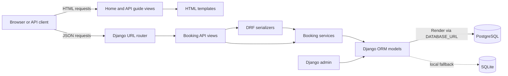
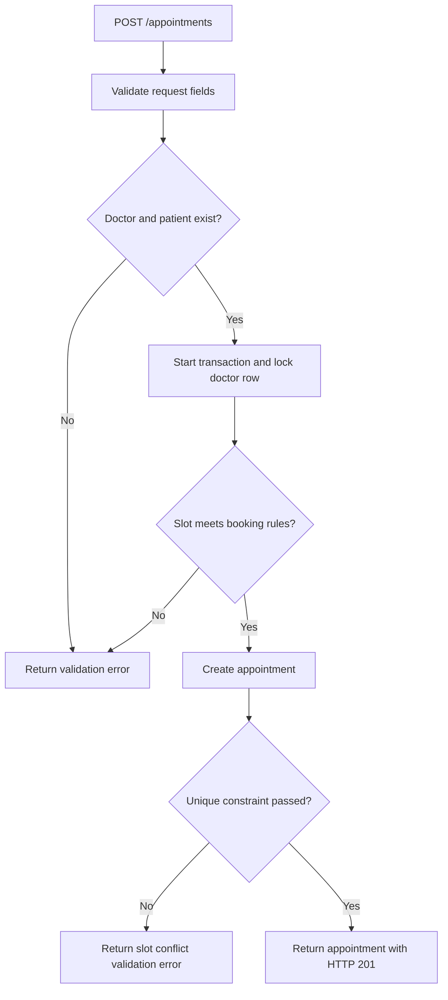

# Savannah Clinic Booking API

A Django REST Framework application for booking clinic appointments. It includes a JSON API, simple server-rendered home and API-guide pages, and Django admin screens for managing doctors, patients, and appointments.

## Submission links

- **Repository:** https://github.com/jjasira/savannah-clinic-booking-api
- **Deployed application:** https://savannah-clinic-booking-api.onrender.com

The deployed service uses Render PostgreSQL through `DATABASE_URL`. Local development uses SQLite by default.

## Contents

- [Section 1 — System design](#section-1--system-design)
- [Section 2 — API implementation](#section-2--api-implementation)
- [Section 3 — Deployment and CI/CD](#section-3--deployment-and-cicd)
- [Section 4 — AI reflection](#section-4--ai-reflection)
- [Run locally](#run-locally)

## Section 1 — System design

### Models and components

- **Doctor** — name and one recurring weekly working day, start time, and end time. Weekdays are numbered Monday `0` through Sunday `6`.
- **Patient** — full name and unique email address.
- **Appointment** — doctor and patient references, timezone-aware start time, status (`booked` or `cancelled`), optional cancellation reason, and created/updated timestamps. Doctor and patient records cannot be deleted while referenced by appointments.
- **Booking services** — validate booking rules, create appointments transactionally, and reschedule appointments.
- **API views and serializers** — expose the endpoints, validate request data, and return JSON responses.
- **Django admin and templates** — allow staff to manage clinic records and provide a small landing page and API guide.
- **Database** — PostgreSQL on Render, selected through `DATABASE_URL`; SQLite is the local fallback.

The project is organized as follows:

```text
savannah_clinic/
├── manage.py                    # Django management commands
├── Procfile                     # Render/Gunicorn start command
├── requirements.txt             # Python dependencies
├── clinic_project/
│   ├── settings.py              # Django, database, REST, and static-file configuration
│   ├── urls.py                  # Admin and bookings URL routing
│   └── wsgi.py                  # Gunicorn WSGI entry point
├── bookings/
│   ├── models.py                # Doctor, Patient, and Appointment models
│   ├── serializers.py           # API input validation and output representation
│   ├── services.py              # Booking rules, transactions, and rescheduling
│   ├── views.py                 # API endpoints and HTML views
│   ├── urls.py                  # Booking API and page routes
│   ├── admin.py                 # Django admin registrations
│   ├── tests.py                 # Booking API tests
│   └── migrations/              # Database schema migrations
├── templates/bookings/          # Shared layout, home page, and API guide
└── .github/workflows/ci.yml     # Tests and Render deploy-hook workflow
```

### System and booking flows



For a new booking, the API validates the request, checks that the doctor and patient exist, validates the slot, then attempts to create the appointment inside a database transaction. A conditional database constraint is the final guard against duplicate active bookings.



### Key decisions and trade-offs

- **Generate availability when requested.** The API derives 30-minute slots from the doctor's schedule and subtracts active appointments rather than maintaining a separate table of pre-generated slots. This keeps appointments as the source of truth and avoids synchronizing stored slots after bookings and cancellations.
- **Protect against double booking in the database.** The application validates availability within a transaction, and a conditional unique constraint on `(doctor, starts_at)` for `booked` appointments handles concurrent attempts. PostgreSQL is used in production for durable data and reliable concurrent writes. SQLite remains convenient for local development.
- **Keep the initial schedule model small.** Each doctor has one recurring weekly workday and time range. This fits the small-clinic scope but does not represent leave, holidays, or schedule exceptions. A future version could add multiple schedule records and exception/leave records.
- **Require timezone-aware appointment times.** API datetimes must include a timezone offset to avoid silently interpreting a booking in the wrong timezone. The configured default timezone is `Africa/Nairobi`.
- **Use a one-hour minimum notice.** This is an optional assessment bonus implemented in the booking validation.

## Section 2 — API implementation

All endpoints are mounted at the site root. Datetimes must be ISO-8601 values with a timezone offset, for example `2026-10-22T09:00:00+03:00`.

| Method | Endpoint | Purpose |
| --- | --- | --- |
| `POST` | `/appointments` | Book an appointment |
| `GET` | `/doctors/{id}/availability?date=YYYY-MM-DD` | Return available 30-minute slots for a doctor and date |
| `PATCH` | `/appointments/{id}/cancel` | Cancel an appointment with a reason |
| `PATCH` | `/appointments/{id}/reschedule` | Move an appointment to a newly validated slot |
| `GET` | `/patients/{id}/appointments` | Return upcoming booked appointments |
| `GET` | `/` | Landing page |
| `GET` | `/doctors/` | Browse doctor IDs and open their next availability query |
| `GET` | `/docs/` | Browser-based API guide |
| `GET` | `/admin/` | Django admin |

### Example requests

Book a slot:

```http
POST /appointments
Content-Type: application/json
```

```json
{
  "doctor": 1,
  "patient": 1,
  "starts_at": "2026-10-22T09:00:00+03:00"
}
```

Check a doctor's availability:

```http
GET /doctors/1/availability?date=2026-10-22
```

The response includes the doctor ID, requested date, and available start times. Dates outside the doctor's configured workday return an empty list.

Cancel an appointment with `{"reason": "No longer needed"}` at `/appointments/{id}/cancel`. Reschedule with `{"starts_at": "2026-10-22T10:00:00+03:00"}` at `/appointments/{id}/reschedule`.

### Validation and tests

Bookings must be at least one hour in the future, fall on the doctor's configured weekday and within working hours, start on a 30-minute boundary, and not conflict with another active appointment. Cancelled appointments release the slot. Rescheduling a cancelled appointment is rejected.

Invalid request data returns meaningful DRF validation errors (HTTP `400`); missing records return HTTP `404`; cancelling an already-cancelled appointment returns HTTP `409`. The current tests cover successful booking and double-booking rejection, cancellation releasing a slot, and rejection of rescheduling a cancelled appointment.

Booking API routes do not currently require authentication. The Django admin is protected by Django authentication. Add appropriate access control before using the API with real patient information.

## Section 3 — Deployment and CI/CD

### Cloud deployment

- **Provider:** Render
- **Database:** Attached Render PostgreSQL database, configured through `DATABASE_URL`
- **Public application URL:** https://savannah-clinic-booking-api.onrender.com

Configure the Render web service with:

| Setting | Value |
| --- | --- |
| Runtime | Python |
| Build command | `pip install -r requirements.txt && python manage.py collectstatic --noinput` |
| Pre-deploy command | `python manage.py migrate` |
| Start command | `gunicorn clinic_project.wsgi:application --bind 0.0.0.0:$PORT` |

Set these environment variables on Render:

| Variable | Purpose |
| --- | --- |
| `DATABASE_URL` | Render PostgreSQL connection string; keep it private |
| `DJANGO_SECRET_KEY` | Secret key for Django |
| `DEBUG` | Set to `False` in production |
| `ALLOWED_HOSTS` | Comma-separated hostnames, including the Render hostname |
| `TIME_ZONE` | Optional; defaults to `Africa/Nairobi` |

The app parses `DATABASE_URL` with `dj-database-url`; when it is absent, it uses `db.sqlite3`. Static files are collected to `staticfiles/` and served by WhiteNoise. The Procfile provides the port-aware Gunicorn start command as well.

### CI/CD pipeline

The GitHub Actions workflow in `.github/workflows/ci.yml`:

1. Runs the Django test suite on every pull request.
2. Also runs tests on pushes to `main`.
3. After a successful push workflow on `main`, sends a request to the Render deploy hook stored in the GitHub Actions secret `RENDER_DEPLOY_HOOK_URL`.

Thus, merges to `main` deploy when they produce a push to that branch and the tests pass. Direct pushes to `main` also trigger deployment; configure branch protection if deployment should only follow reviewed pull requests.

### Run locally

Requirements: Python 3.10 or newer and pip. From the `savannah_clinic` directory:

```powershell
py -m venv .venv
.\.venv\Scripts\Activate.ps1
pip install -r requirements.txt
python manage.py migrate
python manage.py createsuperuser
python manage.py runserver
```

Open `http://127.0.0.1:8000/`, `/docs/`, or `/admin/`. Add doctors and patients through the admin before booking appointments. Run the tests with:

```powershell
python manage.py test
```

If PowerShell prevents virtual-environment activation, use `.venv\Scripts\python.exe` to run the commands directly.

## Section 4 — AI reflection

1. **What I used AI for:** I mainly used AI for debugging and as a coding assistant. I also used it to understand how to deploy the API on Render and configure PostgreSQL for the Render deployment. I used AI to help add function docstrings and type hints and bring the Python code into closer compliance with PEP 8.
2. **A helpful suggestion:** I asked AI for guidance on choosing a database for the deployed app and keeping clinic data between redeployments (this is a paraphrase, not an exact prompt). It suggested using PostgreSQL instead of SQLite in production. This helped during redeployments because users, doctors, and patients remained in the database instead of needing to be added again. The production database now provides data persistence across deployments.
3. **An incorrect or incomplete suggestion:** When I needed to create a superuser on the deployed app, an AI chatbot suggested running the superuser-creation command during deployment. That advice did not fit my free Render plan, which did not provide shell access. After researching the issue further, I found an environment-variable-based workaround that let me solve it while continuing to use the free plan. This taught me to verify deployment advice against the access and features available on the actual hosting plan.
4. **Two decisions I made without AI:**
   - I chose to generate availability from the doctor's schedule when requested rather than store pre-generated slots. For this small application, deriving slots from the schedule and existing appointments keeps the data model simpler and avoids maintaining a separate slot inventory.
   - I kept one recurring weekly schedule per doctor for the initial scope rather than modeling holidays, leave, and schedule exceptions. That keeps the first version focused on the stated requirements; those schedule cases can be added as the clinic's needs grow.
